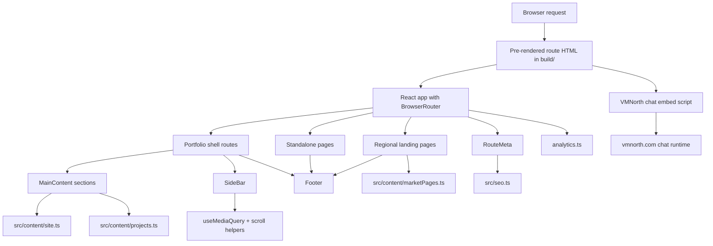

# Architecture

[← Back to documentation hub](./README.md)

## Purpose

The project is a static-hosted React portfolio that combines:

- a one-page scrolling portfolio shell
- deep-linked section routes for the main portfolio flow
- dedicated routed pages for resume and legal content
- regional hiring landing pages for Canada, USA, and Europe
- build-time prerendering for crawlable route HTML
- centralized content and SEO inputs
- persisted browser-only UI state
- an externally hosted VMNorth visitor-chat embed
- automated validation for layout, routing, metadata, and release behavior

## System View

## Route Model

| Route | Role |
| --- | --- |
| `/` | Canonical landing route for the scrolling portfolio shell |
| `/home` | Legacy route that redirects to `/` |
| `/about` | Deep link to the about section |
| `/expertise` | Deep link to the expertise section |
| `/experience` | Deep link to the experience section |
| `/projects` | Deep link to the projects section |
| `/resume` | Dedicated resume page |
| `/privacy` | Privacy notice |
| `/copyright` | Copyright notice |
| `/flipclock` | FlipClock Display product page and Mac App Store entry point |
| `/flipclock/support` | FlipClock Display support page |
| `/flipclock/privacy` | Product-specific privacy policy |
| `/flipclock/terms` | Product-specific terms of use |
| `/canada` | Regional hiring page for Canadian teams |
| `/usa` | Regional hiring page for US teams |
| `/europe` | Regional hiring page for Europe, identified by the generic English `en` alternate |
| `*` | Not-found route rendered through the shared page shell |

### Why this matters

The app uses `BrowserRouter`, but production does not rely on a generic SPA catch-all rewrite. The build pipeline prerenders all known public routes into static HTML and also writes a real `404.html`, which keeps direct links, SEO, and static-hosting compatibility aligned.

## Core Runtime Pieces

| File | Responsibility |
| --- | --- |
| `src/App.tsx` | Router setup, theme state, analytics consent state, shell selection, and shared page-shell composition |
| `src/pages/MainContent.tsx` | Mounts the homepage sections, keeps them in one scroll container, and syncs the URL with scroll position |
| `src/components/scrollToSection/ScrollToSection.tsx` | Scroll restoration and deep-link entry into the correct homepage section |
| `src/components/sideBar/SideBar.tsx` | Desktop navigation, mobile navigation, theme controls, sidebar collapse behavior, and section highlighting |
| `src/pages/market/MarketLandingPage.tsx` | Regional landing page UI for Canada, USA, and Europe |
| `src/pages/resume/Resume.tsx` | Resume page, contact block, and PDF download entry point |
| `src/pages/flipclock/FlipClockPages.tsx` | FlipClock Display landing, App Store CTA, support, privacy, and terms pages |
| `src/pages/legal/LegalDocumentPage.tsx` | Shared legal-page layout used by privacy and copyright routes |
| `src/components/footer/Footer.tsx` | Shared footer, resume CTA, legal links, regional links, and contact entry points |
| `src/components/routeMeta/RouteMeta.tsx` | Runtime updates for title, description, canonical URL, robots, structured data, and alternate links |
| `src/seo.ts` | Shared SEO metadata, structured data generation, robots, sitemap, and route-indexability helpers |
| `src/entry-server.tsx` | SSR entry used only during build-time prerendering |
| `scripts/prerender.mjs` | Generates route HTML, `/home` redirect HTML, `404.html`, `robots.txt`, and `sitemap.xml` after the build |
| `scripts/serve-build.mjs` | Serves the static artifact with route-folder, hosting-rule, and real `404` semantics for release checks |
| `scripts/static-build-smoke.mjs` | Verifies direct routes, metadata, hosting rules, SEO files, and byte-identical resume artifacts |
| `scripts/export-resume.mjs` | Builds the app, serves `build/`, exports `/resume` with Playwright, and synchronizes the PDF into both public and deployable artifacts |
| `index.html` | Boots the React app, loads the site-aware VMNorth embed, and listens for launcher state |

## External Chat Boundary

The portfolio itself has no local application backend, but the production page loads `https://vmnorth.com/chat-embed.js` independently of the optional GA4 consent setting. That script mounts a `vmnorth.com` iframe for the `portfolio` site and connects visitors who use it to the VMNorth chat runtime.

The external runtime can create and restore chat sessions, transmit contact details and messages, upload attachment metadata and bytes when a visitor chooses an attachment, and deliver live updates. VMNorth owns the related APIs and persistence; this repository owns only the embed declaration and the surrounding disclosure. Do not describe production as fully backend-free without this qualification.

The portfolio listens for `vmnorth:chat-widget-state` messages from the VMNorth origin and the `portfolio` iframe. An available, closed widget gets the `data-chat-launcher` attribute. On hover-capable viewports with a fine pointer at 521 px and above, `src/index.scss` gives the launcher a 641 px iframe so its hover label fits while retaining the embed's clipped hit area. Opening the panel removes the override. Touch-only input uses the widget's own sizing.

The main Playwright suite, resume export, and gallery capture block the external script. The dedicated [chat launcher test](../e2e/chat.spec.ts) substitutes a local script and iframe response to verify launcher sizing and opening. Review the [privacy notice](https://viacheslavmurakhin.com/privacy), [legal and brand notes](./legal-and-brand.md), [handoff](./production-handoff.md), and [release checklist](./release-checklist.md) whenever the embed or its data handling changes.

## Homepage Shell Composition

The portfolio shell always mounts the following sequence inside the same scroll container:

1. `Home`
2. `About`
3. `Expertise`
4. `Experience`
5. `Projects`

`MainContent.tsx` uses `IntersectionObserver` to determine which section is currently dominant in view and replaces the URL with the matching route. This keeps the homepage feeling like one continuous product surface while preserving section-level deep links.

## Content Architecture

Shared copy is centralized in the content modules. Product-specific legal copy, resume education, and some UI labels live in their page components.

| Source file | Owns |
| --- | --- |
| `src/content/site.ts` | Identity, navigation labels, target markets, about copy, expertise copy, experience timeline, resume content, Portfolio privacy/copyright copy, and route metadata |
| `src/content/flipClock.ts` | Shared FlipClock Display identity, App Store URL, release metadata, and product route |
| `src/content/projects.ts` | Project IDs, titles, descriptions, proof points, stack labels, actions, and responsive image metadata |
| `src/sections/projects/Projects.tsx` | Default display order and persisted custom order |
| `src/content/marketPages.ts` | Regional landing-page content, market-specific claims, `hreflang` alternates, and regional route metadata |
| `src/utils/contact.ts` | Public email constants used by protected email link rendering |
| `src/pages/flipclock/FlipClockPages.tsx` | FlipClock Display support, privacy, terms, product-specific contacts, and policy date |

This structure prevents copy drift across:

- homepage sections
- sidebar and footer
- routed resume page
- legal pages
- regional landing pages
- SEO metadata and structured data

## Persisted Browser State

| State | Storage | Owner |
| --- | --- | --- |
| Active theme (`dark` / `light`) | `localStorage["theme"]` | `src/App.tsx` |
| Desktop sidebar collapsed state | `localStorage["portfolio-sidebar-collapsed"]` | `src/components/sideBar/SideBar.tsx` |
| Custom project order | `localStorage["vm-projects-order"]` and `localStorage["vm-projects-order-customized"]` | `src/sections/projects/Projects.tsx` |
| Analytics consent | `localStorage["vm-analytics-consent"]` | `src/App.tsx` and `src/utils/analytics.ts` |

These Portfolio-owned states are deliberately browser-local, and the Portfolio has no account system. Separately, the VMNorth embed stores a chat-session credential in browser storage and persists chat sessions, messages, and attachment records through its external backend. Clearing local widget state does not delete that server-side data.

## Styling Strategy

| Scope | Location |
| --- | --- |
| Global tokens, typography, backgrounds, and shell sizing | `src/index.scss` |
| Section-level layout styling | `src/sections/sections.module.scss` |
| Component-level styling | colocated `*.module.scss` files |
| Shared document-page mixins | `src/styles/_documentPage.scss` |

Rules used by the project:

- SCSS Modules are the source of truth for component and page styling.
- Repeated document-page patterns are extracted into shared mixins instead of duplicated between resume, legal, and regional pages.
- Media-query logic is centralized through `useMediaQuery` where responsive runtime behavior is shared.

## SEO and Metadata

The project uses three coordinated metadata layers:

| Layer | Purpose |
| --- | --- |
| `index.html` | Base metadata, theme bootstrap, manifest links, and structured data placeholders |
| `src/content/site.ts` and `src/content/marketPages.ts` | Canonical site metadata plus per-route titles, descriptions, keywords, and regional alternates |
| `src/seo.ts` | Route resolution, robots handling, sitemap generation, structured data, and `hreflang` support |

`src/seo.ts` also models:

- indexable vs non-indexable routes
- sitemap priorities and change frequencies
- professional audience, language, and market targeting
- organization, person, website, breadcrumb, and page schemas
- regional-page alternate links for Canada (`en-CA`), USA (`en-US`), Europe (`en`), and the homepage (`x-default`)

## Operational Notes

Important release-facing behaviors:

- Google Analytics is optional and activates only when a measurement ID is configured and the visitor grants consent.
- The VMNorth chat embed is a separate external integration and is not controlled by the GA4 consent preference.
- The resume PDF is a generated artifact and must be refreshed after resume copy changes.
- Documentation screenshots are release artifacts and should be refreshed after meaningful UI changes.
- Static hosting must serve generated route HTML from `build/`, keep `/home` redirect output intact, and return `404.html` for unknown paths.
