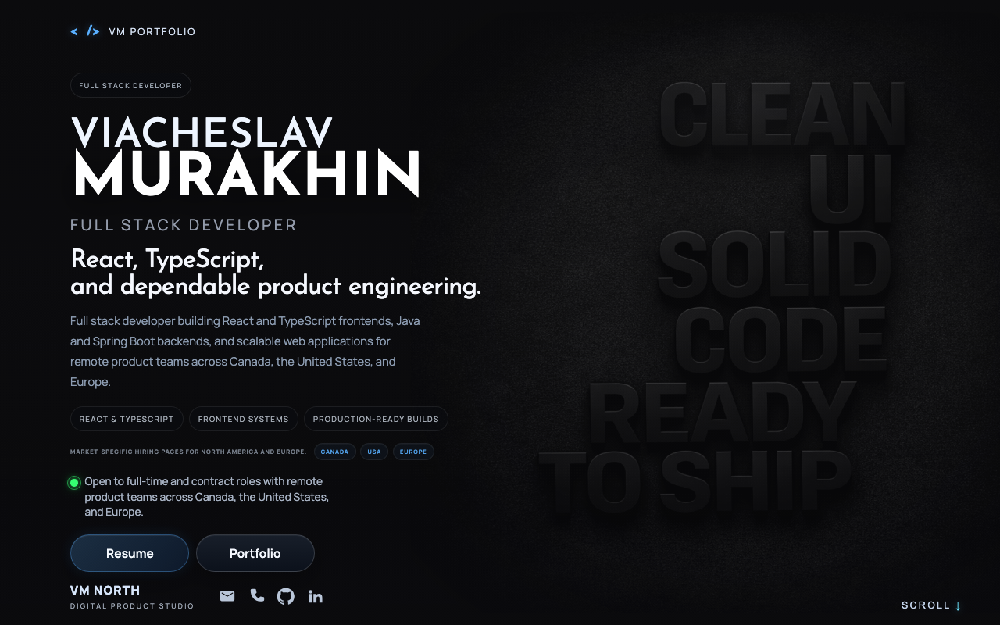
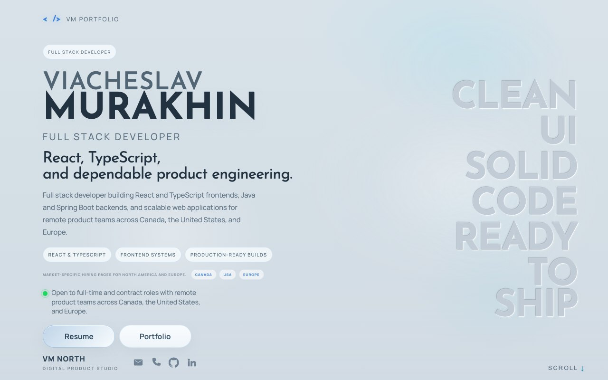
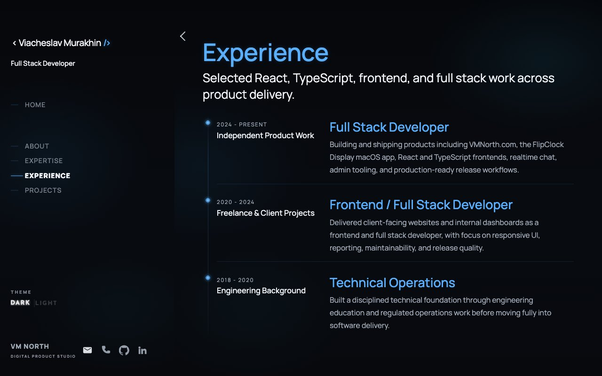
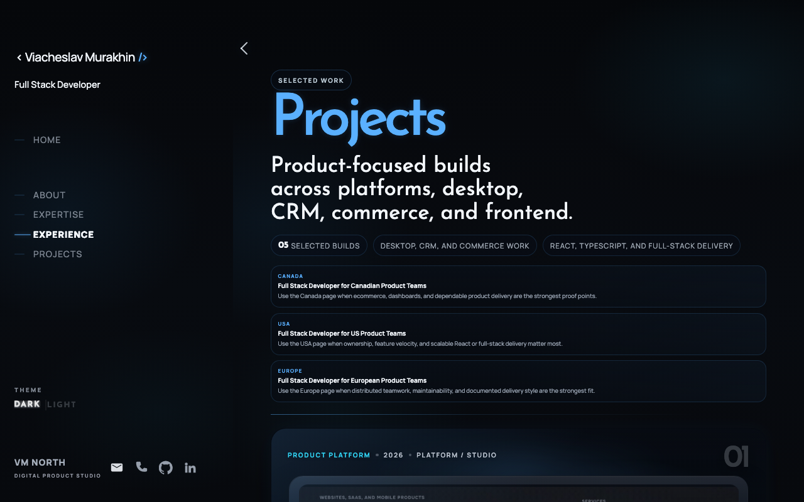
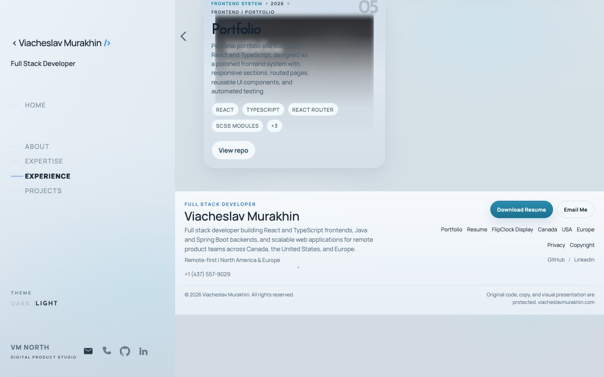
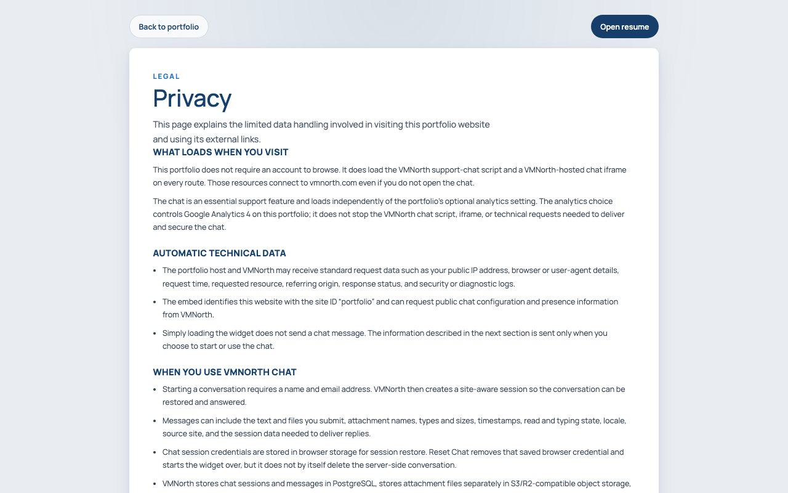
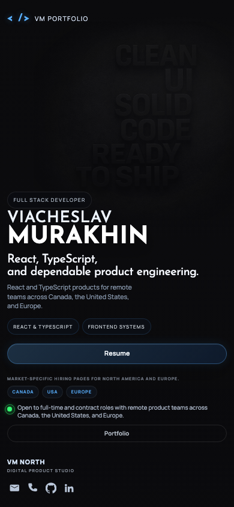
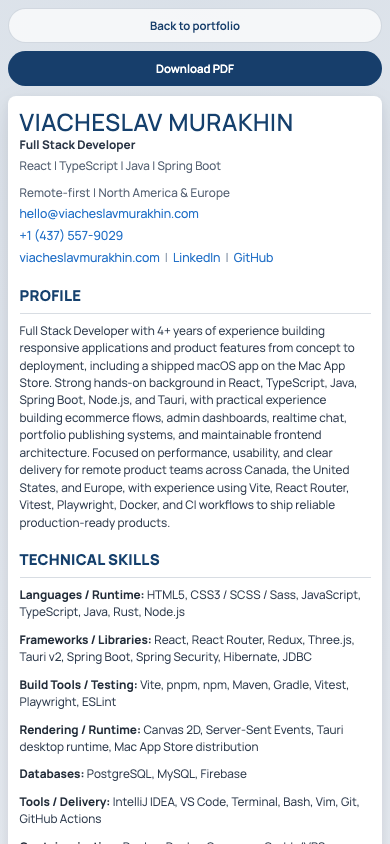
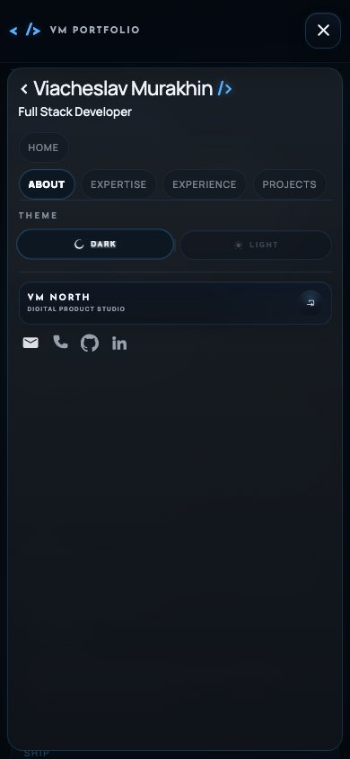
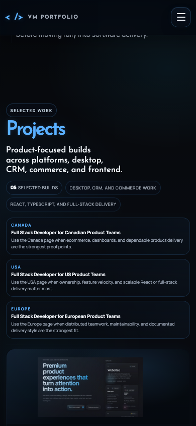

# Visual Gallery

[← Back to documentation hub](./README.md)

This gallery contains dated repository snapshots across desktop, mobile, theme, content, and legal surfaces. The images support release review and visual comparison; they are not continuous proof of the currently deployed site's state.

Use it for:

- release reviews
- documentation handoff
- design comparisons
- content verification

## Refresh Metadata

| Field | Value |
| --- | --- |
| Last refreshed | 2026-08-31 |
| Source state | Captures were committed with the [2026-08-31 documentation update](https://github.com/WenziLikes/Portfolio/commit/78927aa). |
| Capture command | `npm run docs:screenshots` |
| Desktop viewport | 1280 × 800 |
| Mobile viewport | 390 × 844 |
| Capture controls | Local Vite development server, explicit light/dark theme, analytics consent set to denied, screenshot animations disabled, and the external VMNorth chat script blocked |
| Artifact scope | Release-support files in `docs/assets/`; they are not copied into the production `build/` by default |

These screenshots document the captured portfolio UI. Use the [chat checks in the release checklist](./release-checklist.md#6-privacy-and-external-services) to review the launcher and panel on a deployed site.

## Desktop

### Homepage hero, dark theme

### Homepage hero, light theme

### Experience section

### Projects section

### Footer, light theme

### Privacy page

## Mobile

### Homepage hero

### Resume page

### Mobile menu open

### Projects on mobile

## Maintenance

Install Chromium with `npm run test:e2e:install` before the first capture. Run `npm run docs:screenshots` when a captured UI state changes, review every generated image, and update the refresh date and source reference. The screenshot runner and static E2E server both use port 4181, so run them separately.
